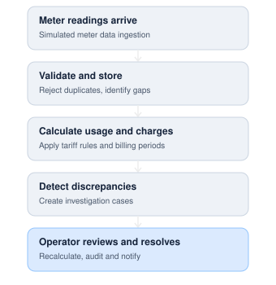
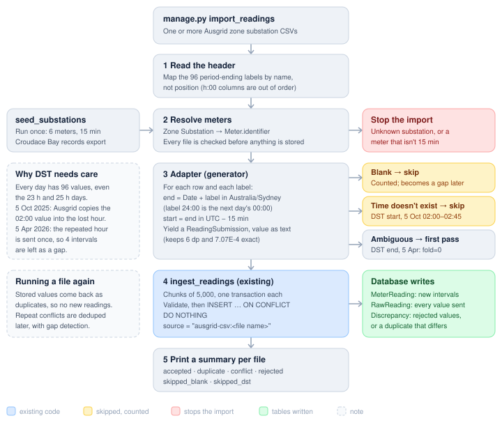
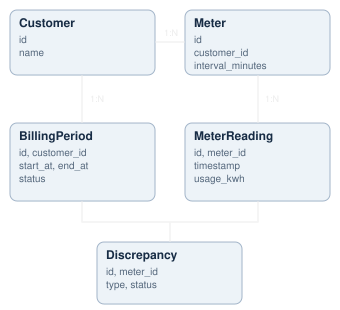

# GridOps

An internal operations tool for an electricity retailer. It takes in meter readings, finds
missing, duplicate and suspicious data, calculates charges and helps operators resolve billing
discrepancies **without ever losing track of what happened**.

The data is real: a year of 15-minute load readings from six Ausgrid zone substations in Sydney,
about 210,000 values, from Ausgrid's public
[distribution zone substation data](https://www.ausgrid.com.au/about-us/about-ausgrid/research-data-sets/distribution-zone-substation-data).

> **Status:** work in progress, Milestone 1 of 4. The domain model and the validation and storage layer
> are built and tested. The CSV import is designed (see [CSV import](discovery/csv-import.md)) and
> is the next piece of work.

---

## At a glance

| | |
|---|---|
| **Problem** | Meter data arrives late, twice, in mixed units, with gaps and with bad values. Bills depend on it, so every correction has to leave an audit trail. |
| **Stack** | Python 3.13 · Django 6.1 · PostgreSQL 18 · Celery 5.7 with Redis 8.8 · Docker Compose · uv. Planned: React and GraphQL. |
| **What it shows** | Domain modelling, data integrity enforced in the database, safe retries (idempotency), concurrency-safe ingestion and documented trade-offs. |
| **Tests** | 28 tests: unit tests for the validation rules and database-backed tests for ingestion. |

## What the system does



1. **Readings arrive** from files or (later) an API.
2. **Validate and store:** every submission is recorded first. Valid readings are stored once per meter and interval.
3. **Calculate usage and charges** over billing periods (Milestone 3).
4. **Detect discrepancies:** gaps, conflicting duplicates and suspicious values.
5. **Operators review and resolve** them, with history kept intact (Milestone 2).

## Roadmap

| Milestone | Scope | Status |
|---|---|---|
| 1. Domain model and API | Django/Postgres models, validation, ingestion, CSV import, gap detection, API | **In progress** |
| 2. Operator UI | React interface for readings, discrepancies and investigation status, served over GraphQL | Planned |
| 3. Background processing | Celery jobs for bill calculation and recalculation, with retries, duplicate jobs, partial failures and idempotency | Planned |
| 4. Production engineering | Structured logs, error tracking, metrics, failure scenarios and an incident postmortem | Planned |

**Done so far**
- Docker Compose for Postgres and Redis, Django settings loaded from `.env`, a Celery app, and a `/health/` endpoint
  that checks the database, the cache and the Celery broker.
- Domain model with database-level constraints ([domain model](discovery/domain-model.md)).
- The validation and ingestion service (`metering/ingestion/`) with 28 tests.
- An analysis of the real data, plus the import design, which turned up a daylight-saving problem (below).

**Next**
- CSV import command.
- Gap detection as a Celery task, with discrepancies that don't duplicate.
- A reproduced concurrency bug with a written postmortem.
- Spike detection.

## Design decisions and trade-offs

These are the choices most worth discussing. Each one has a reason and an alternative that was rejected.

**1. Nothing received is ever lost.**
Every submission is stored as a `RawReading` exactly as it arrived (value, sign, unit and source), *before*
validation. Only valid submissions become a `MeterReading`. Rejected and duplicate submissions stay auditable
and link to the reading they produced or collided with.
*Trade-off:* about 320 bytes per reading across both tables (measured). That's fine at this scale. At larger
scale I'd add monthly partitions and a retention or archiving policy.

**2. Retries are safe, and history never changes silently.**
- An identical resubmission is a harmless duplicate: no new reading and no alert.
- A *different* value for an interval that already has a reading is also a duplicate. It does **not**
  overwrite the stored value. Instead it opens a `duplicate_reading` discrepancy for an operator to review.

A billed number can't change quietly.

**3. Concurrency-safe inserts.**
Readings are inserted with `INSERT … ON CONFLICT DO NOTHING` (fed by `unnest` arrays) against a unique
`(meter, interval_start)` constraint. When two imports race on the same interval, the loser waits and then
skips the row instead of raising an error, and the row is reported as a duplicate. Large imports are
processed in chunks of 5,000 rows, each in its own transaction. A failure part-way keeps the finished
chunks, and re-running the import picks up where it stopped.

**4. Invariants live in the database, not just in Python.**
These rules are Postgres constraints:
- usage and export are never negative
- one reading per meter per interval
- a rejected submission must have a reason
- an accepted submission must link to its reading

Foreign keys use `PROTECT`, so deleting a customer or meter can never cascade away billing history.

**5. Validation sits in a service layer, not in `Model.clean()` or serializers.**
`bulk_create` skips `clean()`, and several checks need context from the batch or the database. The
single-reading rules in `validators.py` are pure functions with no database access and the current time
passed in. Every ingestion path (CSV, API, Celery) can reuse them and they're easy to unit test.

**6. Export is its own column, not negative usage.**
Some readings are negative, most likely rooftop solar feeding back into the grid. Allowing negative usage
would lose the database guard against bad data. Instead, a negative value is split into a non-negative
`export` column, and only on meters flagged `records_export`. On any other meter it's rejected as
suspicious. Keeping import and export separate also allows separate pricing for exported energy.

**7. Units are normalised once, and the original is kept.**
Readings can arrive in kWh or MW. MW is average power, so it's converted to energy for the interval
(`MW × 1000 × minutes / 60`). `MeterReading` always stores kWh, and `RawReading` keeps the original
value and unit at full precision.

More notes: [discovery/decisions.md](discovery/decisions.md).

## Working with real data

The sample data is zone substation load data published by Ausgrid
([Distribution zone substation data](https://www.ausgrid.com.au/about-us/about-ausgrid/research-data-sets/distribution-zone-substation-data)).
It covers May 2025 to April 2026 for six substations, with 15-minute MW values: 209,472 data points.
Ausgrid owns the copyright, so the files aren't included in this repo. See [Getting the data](#getting-the-data).

Ausgrid says the data comes raw from its SCADA and metering systems and isn't validated. Some MW values are
estimated from current using an assumed power factor. That makes it a good test bed. Findings from the
analysis:

- **Gaps:** Darlinghurst is missing 8 whole days (13–20 March 2026). There are 1,218 blank values in total.
- **Column order:** each `h:00` column sits *after* `h:45` in the file. A statistical check showed the labels
  are correct, so the import maps columns by header name, never by position.
- **Negative values:** only one substation (Croudace Bay) has them: 3,750 values, all between 08:00 and 18:00,
  peaking at midday and varying with the season. That fits solar export.
- **Daylight saving:** times are Sydney clock time (AEST in winter and AEDT in summer, as Ausgrid states), yet **every day has exactly 96 values**, including the
  23-hour and 25-hour changeover days. Ausgrid fills the skipped hour with repeated values and sends the
  repeated hour only once. A naive conversion with Python's `zoneinfo` would quietly move the non-existent
  times onto real ones and clash with real readings. The import detects these times and skips them
  explicitly. Details: [CSV import](discovery/csv-import.md).



## Domain model



| Entity | Responsibility |
|---|---|
| Customer | The account receiving electricity |
| Meter | A device supplying data at a fixed interval. It may record export. |
| RawReading | Every submission exactly as received, with its outcome |
| MeterReading | Validated energy imported and exported for one interval |
| BillingPeriod | A start-inclusive, end-exclusive window for aggregating usage |
| Discrepancy | A detected data problem awaiting investigation: open or resolved |

Full rules and field lists: [discovery/domain-model.md](discovery/domain-model.md).

## Assumptions

- Each meter belongs to one customer and reports at a fixed interval.
- Readings are consumption per interval, not cumulative register totals.
- Readings can arrive out of order, more than once, or never.
- Croudace Bay's negative values are solar export. This fits the data, but Ausgrid hasn't confirmed it.
- On the day clocks go back, the single set of values for the repeated hour belongs to the first pass.
- Interval alignment is measured from UTC midnight. This is correct for whole-hour offsets such as Sydney's.

## Testing

```bash
uv run python manage.py test metering
```

- **Validation rules (unit tests, no database):**
  - unit conversion
  - scientific notation and source precision
  - negative values on export and non-export meters
  - blank and non-numeric values
  - timestamps without a time zone, intervals off the 15-minute grid, and intervals that haven't finished
  - several errors reported together
- **Ingestion (against Postgres):**
  - identical and conflicting resubmissions
  - duplicates within one batch
  - re-running an import
  - out-of-order readings
  - the same instant submitted in different time zones
  - unknown meters
  - independent chunk transactions
  - storing export

**Planned:** a `TransactionTestCase` with two threads racing on the same interval. It will reproduce a real
concurrency bug for the postmortem in Milestone 4.

## What I'd change at scale

- **Partition** `RawReading` and `MeterReading` by month, and move old raw submissions to cheaper storage.
- Add an **ingestion batch** table to track each file or API call, its status and its counts.
- Move to **RabbitMQ** (or SQS) for Celery. Redis was chosen because it's simple to run locally, but it doesn't
  guarantee delivery.
- Use **real meter identifiers** (NMI and meter serial) instead of a free-text name.
- Add **exclusion constraints** (`btree_gist`) to stop billing periods overlapping.
- Use a **managed Postgres** service, chosen with data residency and the read/write load in mind.

## Running locally

Requires Docker and [uv](https://docs.astral.sh/uv/).

```bash
cp .env.example .env            # then set the passwords and secret key
docker compose up -d            # Postgres 18 and Redis 8.8, bound to 127.0.0.1
uv sync
uv run python manage.py migrate
uv run python manage.py runserver 127.0.0.1:8000
# health check: http://127.0.0.1:8000/health/

# Celery worker (on Windows, add --pool=solo)
uv run celery -A gridops worker -l info
```

The tests don't need the data files.

### Getting the data

Ausgrid keeps the copyright on its zone substation data, so the CSVs aren't committed (`data/` is git-ignored).
To get them:

1. Open Ausgrid's [Distribution zone substation data](https://www.ausgrid.com.au/about-us/about-ausgrid/research-data-sets/distribution-zone-substation-data)
   page and download **"Distribution Zone Substation Data 2026"**. It's a zip of about 25 MB with one CSV per
   substation. Each Ausgrid year runs from May to April; in these files the `year` column is `2026` and the
   dates run from 2025-05-01 to 2026-04-30.
2. Extract these six files into `data/`:
   - `Croudace Bay 33_11kV FY26.csv`
   - `Crows Nest 132_11kV FY26.csv`
   - `Croydon 132_11kV FY26.csv`
   - `Dalley St 132_11kV FY26.csv`
   - `Darling Harbour 132_11kV FY26.csv`
   - `Darlinghurst 33_11kV FY26.csv`

   Any other substation in the zip works too, as long as a matching meter exists.

## Repository layout

```
gridops/              Django project: settings, Celery app, health check
metering/
  models.py           domain model and database constraints
  ingestion/
    validators.py     pure single-reading rules
    service.py        chunked, idempotent, concurrency-safe ingestion
  tests.py
data/                 Ausgrid CSVs (git-ignored; see Getting the data)
discovery/            problem statement, milestones, domain model, decisions, import design
```
