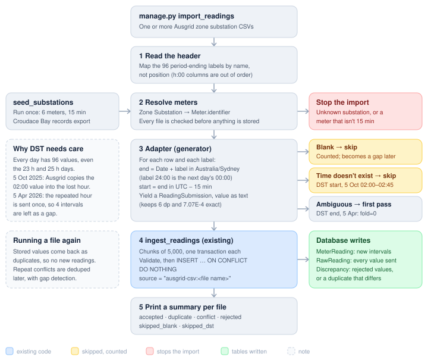

# CSV import

How `manage.py import_readings` turns Ausgrid zone substation CSVs into readings.
The command is a thin layer: all validation and storage goes through the existing
`ingest_readings()` in `metering/ingestion/service.py`.

| Piece | File |
|---|---|
| Adapter (pure, no database) | `metering/ingestion/sources/ausgrid_csv.py`: `check_header`, `read_substations`, `period_end_utc`, `iter_submissions` |
| Import command | `metering/management/commands/import_readings.py` |
| Meter setup | `metering/management/commands/seed_substations.py` |
| Tests | `AusgridAdapterTests`, `ImportReadingsCommandTests` and `SeedSubstationsCommandTests` in `metering/tests.py` |

The import works in two passes. **Pass 1** checks every file's header and resolves every substation
to a meter, storing nothing. **Pass 2** streams each file through the adapter into `ingest_readings`.

## On the real FY26 files
Run through the adapter (no database needed):

| File | Days | Submitted | Blank skipped | DST skipped |
|---|---|---|---|---|
| Croudace Bay 33_11kV | 365 | 35,028 | 8 | 4 |
| Crows Nest 132_11kV | 365 | 34,946 | 90 | 4 |
| Croydon 132_11kV | 365 | 34,944 | 92 | 4 |
| Dalley St 132_11kV | 365 | 34,947 | 89 | 4 |
| Darling Harbour 132_11kV | 365 | 34,828 | 208 | 4 |
| Darlinghurst 33_11kV | 357 | 33,537 | 731 | 4 |
| **Total** | **2,182** | **208,230** | **1,218** | **24** |

Submitted, blank and DST add up to 209,472 values, which is every value in the files. No interval is
submitted twice within a file. Parsing takes about 0.1 s per file.

**Imported into Postgres (2026-11-24, dev machine, Postgres 18 in Docker):**
- First run: every submitted value was accepted, with 0 duplicates and 0 rejected. Each file took 3.7–4.0 s, roughly
  8,800 readings a second including the raw records, and all six files took about 23 s.
- Second run: all 208,230 came back as duplicates, with 0 conflicting, in 3.4–3.6 s per file.
- Database afterwards:
  - 208,230 MeterReadings
  - 416,460 RawReadings (one `accepted` and one `duplicate` per value)
  - 0 Discrepancies
  - 3,750 readings with export, all on Croudace Bay, matching its negative values
  - each meter runs from 2025-04-30 14:00 UTC (1 May 00:00 AEST) to 2026-04-30 13:45 UTC

## Source
- Ausgrid, [Distribution zone substation data](https://www.ausgrid.com.au/about-us/about-ausgrid/research-data-sets/distribution-zone-substation-data):
  one zip per year with one CSV per zone substation. The sample is the zip labelled **2026**, covering
  2025-05-01 to 2026-04-30, for six substations.
- Ausgrid keeps the copyright, so the files aren't committed. `data/` is git-ignored, and the README's
  *Getting the data* section explains how to download them.
- Ausgrid describes the data as raw SCADA and metering output with no validation. It mentions transient
  and sustained gaps, switching spikes and dips, and MW values estimated from current at some sites. It
  states times as AEST in winter and AEDT in summer, but doesn't say how changeover days are handled.

## File format
- One row per day. The columns are `year, Zone Substation, Date, Unit`, followed by 96 labels from `00:15` to `24:00`.
- `year` is Ausgrid's reporting year (May to April) and is ignored.
- Labels are **period ending**: `00:15` covers 00:00–00:15. `24:00` is the next day's 00:00.
- The `h:00` columns come after `h:45` in the file, so columns are mapped **by header name**, never by position.
- `Unit` is always `MW` (average power over the interval). `validators.to_kwh` converts it to kWh.
- Values are passed on as text, so 6 decimal places and `7.07E-4` reach `parse_usage` exactly.
- A full file is 365 × 96 = 35,040 values, which `ingest_readings` processes as 8 transactions of 5,000.

## Meters
- `Zone Substation` is matched to `Meter.identifier`.
- Every file's substations are resolved **before anything is stored**. An unknown substation, or a meter whose
  `interval_minutes` isn't 15, stops the import. Typos fail loudly instead of creating meters.
- Meters come from a separate one-off `seed_substations` step: the 6 substations, all 15-minute, with
  `records_export=True` on Croudace Bay only (see the assumptions below).

## Times and daylight saving
Labels are Sydney wall-clock time, which matches Ausgrid's AEST/AEDT statement. The average daily load profile
doesn't shift around either changeover. Even so, **every day has exactly 96 values**, including the 23-hour and
25-hour days. For each label the adapter computes `end = Date + label` in `Australia/Sydney`, converts it to
UTC and sets `start = end − 15 min`.

| Day | What Ausgrid sends | What the import does |
|---|---|---|
| 2025-10-05, DST starts (02:00 → 03:00) | Labels `02:00` to `02:45` are wall-clock times that don't exist. Most files repeat one value across `02:00`–`03:00`. | The adapter detects them with a local → UTC → local round trip and **skips** all four (`skipped_dst`). That leaves 92 values for a 23-hour day. Without this, `zoneinfo` would quietly turn `02:15` into `03:15` and clash with the real `03:15` value. `02:00` AEST and `03:00` AEDT are the same instant, so the `03:00` label keeps that interval. |
| 2026-04-05, DST ends (03:00 → 02:00) | The repeated hour is sent only once. | Ambiguous labels (`02:00`–`02:45`) use `fold=0` (the first pass, AEDT). The quarter-hours with no value are left for gap detection to report as missing. |

Sydney's offsets are whole hours, so every interval start stays aligned to the 15-minute grid that
`validators.is_aligned` measures from UTC midnight.

## Blanks
Blank values (1,218 in the sample) are **not submitted**. They're counted as `skipped_blank`, and gap detection
records them as `missing_reading` ranges. That gives one discrepancy of the right type, instead of a
`suspicious_reading` followed by a second, missing-interval discrepancy for the same interval.

## Running a file again
`ingest_readings` reports stored values as duplicates, so re-running an import adds no readings. A new
RawReading still records each attempt. A value that differs from what's stored (for example from a
corrected file) would raise its `duplicate_reading` discrepancy again on each run. The "skip if an open
discrepancy already exists" rule planned alongside gap detection has to cover that type as well.

## Output
After each file, the command prints `accepted · duplicate · conflict · rejected · skipped_blank · skipped_dst`.
`--dry-run` parses and resolves the file without storing anything.

## Assumptions
- Croudace Bay's negative values are solar export (`records_export=True`). The data doesn't confirm this.
- On the DST-end day, the single set of `02:00`–`02:45` labels belongs to the first pass (AEDT).
- On the DST-start day, the `03:00` value is the real reading for 01:45–02:00 AEST and the skipped labels are padding.
  In most files all five values are identical. Croudace Bay's differ, so its skipped values may not be pure padding.
