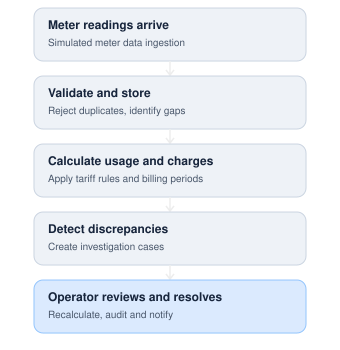

internal tool for an energy retailer

Customers have electricity meters that report usage periodically. 
The retailer needs to:
    - calculate charges
    - detect missing or suspicious readings
    - flag missing or duplicate readings
    - resolve billing discrepancies without losing track of what happened

