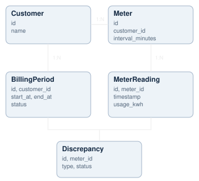

| Entity | Responsibility |
| --- | --- |
| Customer | Represents the account receiving electricity service |
| Meter | Identifies the device supplying usage data and its expected reading interval |
| MeterReading | Stores the electricity consumed during a specific interval |
| BillingPeriod | Defines the time window over which usage is aggregated |
| Discrepancy | Tracks a detected data problem requiring investigation |

For V1, assume: 
- each meter belongs to one customer, 
- reports consumption in kWh every 30 minutes, 
- and that all readings are interval consumption values rather than cumulative meter total

A meter should have at most one accepted reading for a given interval start.
Usage cannot be negative.
Readings can arrive out of chronological order.
Missing intervals should be detectable.
A billing period uses a start-inclusive, end-exclusive time window.
A duplicate submission should not double-count consumption.
A discrepancy can be open or resolved.